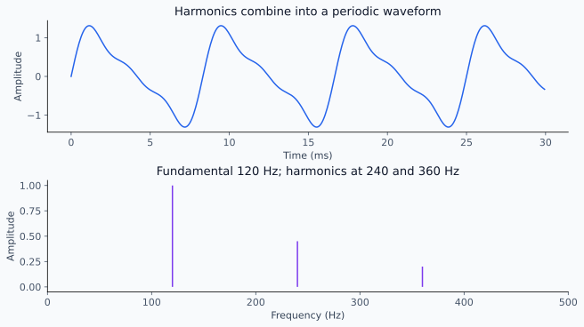
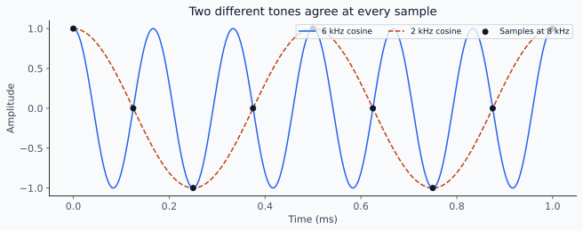
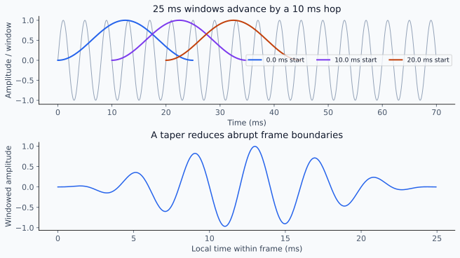
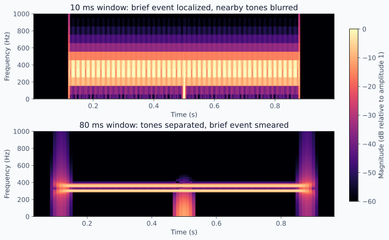
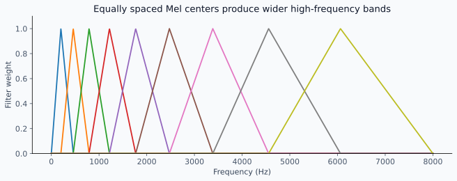
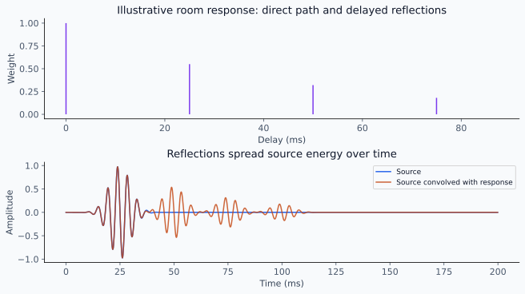

# Speech / Audio ML Interview Study Guide

A standalone guide for mid-to-senior ML-domain interviews: 31 lessons across six Parts.

Study in curriculum order on a first pass. Each lesson builds from intuition to mechanism, essential math, practical consequences, tradeoffs, and failure modes.

## Contents

- Part 1 — Audio Signals and Representations
  - 1.1 Sound, speech, and the information in a waveform
  - 1.2 Digital audio: sampling, quantization, and audio tensors
  - 1.3 Frequency-domain reasoning and the Fourier transform
  - 1.4 Short-time analysis: windowing, spectrograms, and reconstruction
  - 1.5 Perceptual features: log spectra, Mel spectrograms, and cepstral features
  - 1.6 Filtering, recording channels, and audio preprocessing
- Part 2 — The Machine-Learning Foundations Audio Actually Needs
  - 2.1 Mathematical tools and probabilistic prediction
  - 2.2 Neural prediction, losses, and learning
  - 2.3 Convolutional audio encoders and temporal resolution
  - 2.4 Sequence modeling and variable-length audio
  - 2.5 Attention, Transformers, and convolution–attention hybrids
  - 2.6 Pretraining, self-supervision, and transfer learning
- Part 3 — Speech Recognition and Sequence Alignment
  - 3.1 From speech to prediction targets
  - 3.2 Connectionist Temporal Classification and latent alignment
  - 3.3 Label-dependent recognition: transducers and attention encoder-decoders
  - 3.4 Recognition decoding, language models, and contextual biasing
- Part 4 — Understanding Speakers, Events, and Acoustic Mixtures
  - 4.1 Audio classification, event detection, and keyword spotting
  - 4.2 Speaker embeddings, identification, and verification
  - 4.3 Voice activity detection and speaker diarization
  - 4.4 Speech enhancement, source separation, and acoustic echo cancellation
  - 4.5 Audio–text representations and semantic audio understanding
- Part 5 — Speech and Audio Generation
  - 5.1 Text-to-speech: linguistic preparation, alignment, and prosody
  - 5.2 Generative modeling: autoregression, parallel prediction, and iterative refinement
  - 5.3 Waveform synthesis, neural vocoders, and audio codecs
  - 5.4 Conditioned generation and speech–language systems
- Part 6 — Building and Operating Speech / Audio ML Systems
  - 6.1 Problem formulation, datasets, labels, and baselines
  - 6.2 Robust training, augmentation, and domain adaptation
  - 6.3 Evaluation metrics and systematic error analysis
  - 6.4 Streaming, causality, endpointing, and latency
  - 6.5 Efficient inference and deployment tradeoffs
  - 6.6 End-to-end system design, monitoring, and iteration

# Part 1 — Audio Signals and Representations

Understand audio capture, frequency structure, feature extraction, and the information preprocessing changes.

## 1.1 Sound, speech, and the information in a waveform

### 1. A recording measures pressure over time

Sound is a pressure disturbance traveling through a medium. A microphone converts local pressure variation into an electrical signal; a digital recording samples that measurement. A **waveform** plots amplitude against time. It contains the combined effects of the source, room, microphone, and recording chain.

Two recordings of the same words can differ greatly. Before selecting a model, ask which information should survive those differences: word identity, speaker identity, a cough, or the whole acoustic scene.

### 2. Frequency, amplitude, and phase

A sinusoid is a single repeating oscillation:

\[
x(t)=A\sin(2\pi ft+\phi)
\]

Here t is time in seconds, A is amplitude, f is frequency in hertz (cycles per second), and φ is phase in radians. Increasing f shortens the period, T = 1/f; increasing A increases signal magnitude; changing φ shifts the oscillation in time.

Real sounds combine many components. Amplitude is related to loudness, but perceived loudness also depends on frequency, duration, and the listener.

### 3. Energy and level

For N discrete samples x[n], mean-square power and root mean square (RMS) summarize magnitude:

\[
P=\frac{1}{N}\sum_{n=0}^{N-1}x[n]^2,\qquad x_{\mathrm{RMS}}=\sqrt{P}
\]

N is the number of samples. A short loud impulse and sustained speech may have similar peaks but different average power.

**Decibels** express a ratio: power level is 10 log10(P/Pref); amplitude level is 20 log10(A/Aref) when power is proportional to squared amplitude. Always state the reference; digital level alone does not establish physical sound pressure.

### 4. Pitch, harmonics, and timbre

A periodic source has a **fundamental frequency**, f0, and may have harmonics near integer multiples of f0. **Pitch** is the perceptual sense of high or low; it often follows f0 but is not simply the largest spectral peak.

**Timbre** distinguishes sounds with similar pitch and loudness through spectral shape and temporal evolution. The missing fundamental can still be perceived from harmonic spacing.



An illustrative 120 Hz fundamental and its harmonics combine into a waveform. Harmonic spacing and relative amplitudes describe different aspects of the sound.

### 5. How speech is produced

Voiced speech uses approximately periodic vocal-fold excitation; the vocal tract shapes its spectral envelope. Its resonances are **formants**. Changing vocal-tract shape changes vowel quality without requiring the same change in pitch.

Unvoiced sounds, such as many fricatives, contain turbulence-like excitation. Stops include closures and short bursts. Whispering can convey words without ordinary vocal-fold periodicity.

```text
excitation → vocal-tract resonances → radiated sound → room → microphone
```

### 6. Speech is not a sequence of isolated sounds

A **phoneme** is a language-specific sound category that can distinguish words. Its realization varies with neighboring sounds, speaking rate, and speaker; this interaction is **coarticulation**.

Consequently, word boundaries need not contain silence, and fixed-duration slices do not map cleanly to letters. Recognition must handle variable timing; speaker models should preserve identity while tolerating word changes.

### 7. Practical inspection

Listen to the recording and inspect waveform, level, silence, and clipping before relying on features. A waveform can reveal dropouts and timing, but is difficult to read linguistically; later frequency representations expose resonance and harmonic structure.

---

## 1.2 Digital audio: sampling, quantization, and audio tensors

### 1. A sample index needs a clock

A digital waveform is a sequence x[n] together with a sample rate fs. Sample n corresponds to time n/fs seconds. Without fs, the array does not determine playback speed or frequency.

At 16,000 samples/second, one second of mono audio contains 16,000 samples. The same array interpreted at 8,000 samples/second lasts twice as long and sounds lower.

### 2. Sampling and aliasing

Sampling makes distinct continuous frequencies indistinguishable if they differ by sampling-rate multiples. For a band-limited signal, the sample rate must exceed twice its highest frequency; fs/2 is the **Nyquist frequency**.



At an 8 kHz sample rate, 6 kHz and 2 kHz cosines produce identical samples. An anti-aliasing filter must remove unsupported frequencies before sampling or downsampling.

At fs = 8 kHz, a 6 kHz sinusoid aliases to 2 kHz. Once sampled without suitable filtering, the recording alone cannot identify which original frequency occurred.

### 3. Resampling changes the grid

Downsampling requires suppressing frequencies above the new Nyquist limit before reducing the sample count. Upsampling inserts a finer grid and interpolates appropriately; it does not restore information absent from the original capture.

**Relabeling the sample rate is not resampling.** To convert one second from 48 kHz to 16 kHz, compute approximately 16,000 new samples rather than keeping 48,000 samples with a different header.

### 4. Quantization, clipping, and encoding

**Quantization** maps amplitudes to discrete levels. With b bits, an ideal scalar quantizer has 2^b levels; fewer bits generally increase quantization error for a fixed range.

**Clipping** saturates values outside the allowed range and irreversibly distorts peaks. Converting a clipped integer recording to floating point cannot recover them.

Pulse-Code Modulation (PCM) stores sample values directly; file containers and compression schemes are separate choices. A Waveform Audio File Format (WAV) container is not a guarantee of one specific sample encoding.

### 5. Channels and tensor shapes

| Object | Typical shape | Meaning |
|---|---|---|
| Mono recording | N | One time series |
| Multichannel recording | C × N | C synchronized channels |
| Padded waveform batch | B × C × Nmax | B examples plus true lengths |
| Feature batch | B × F × T | Frequency/features and frames |

Layouts vary by library. Never infer which axis is time from dimension count alone.

Averaging channels can reduce independent noise but can cancel out-of-phase signals and destroy spatial cues. Select or combine channels according to the task.

### 6. A concrete size calculation

Uncompressed storage, excluding headers, is:

\[
\text{bytes}=\text{duration}\times f_s\times C\times b/8
\]

Duration is in seconds, C is channel count, and b is bits per sample. Ten seconds of 16 kHz, mono, 16-bit PCM occupies 320,000 bytes. Model float32 tensors require more memory than the original 16-bit samples.

### 7. A tiny compatibility check

Assume torch is PyTorch and torchaudio is imported; waveform has shape C × N and source_rate comes from the decoder:

```python
target_rate = 16000
audio = torchaudio.functional.resample(waveform, source_rate, target_rate)
duration = audio.shape[-1] / target_rate
```

Check the chosen pretrained model's documented rate, channel policy, scaling, and frontend; 16 kHz is an example, not a universal audio standard.

---

## 1.3 Frequency-domain reasoning and the Fourier transform

### 1. Ask which oscillations explain the signal

Time-domain samples describe when amplitude changes. A frequency representation describes how strongly different oscillations contribute. These are alternative views of the same finite sequence when the complete complex transform is retained.

A sustained vowel has repeating structure that is hard to summarize sample by sample but produces an informative harmonic spectrum.

### 2. Complex numbers encode two coordinates

Write a complex value as a + jb, where j squared is −1. Its magnitude is sqrt(a² + b²); its angle describes phase. The identity exp(jθ) = cos θ + j sin θ packages two oscillations into one expression.

A Fourier coefficient measures agreement with cosine and sine reference waves, giving both contribution strength and relative phase.

### 3. The discrete Fourier transform

For N samples, the **Discrete Fourier Transform (DFT)** is:

\[
X[k]=\sum_{n=0}^{N-1}x[n]e^{-j2\pi kn/N},\qquad f_k=\frac{kf_s}{N}
\]

X[k] is bin k's complex coefficient; n indexes time, fs is sample rate. The **Fast Fourier Transform (FFT)** computes this transform efficiently, typically in order N log N operations instead of order N².

For real signals, negative-frequency coefficients are conjugate mirrors, so a one-sided representation retains the nonredundant bins.

### 4. Bin spacing is not unlimited resolving power

Bin spacing is fs/N. At 16 kHz, a 400-sample frame spans 25 ms and gives 40 Hz spacing without padding.

Padding those samples to a longer transform interpolates the spectrum onto more bins; it does not extend the observation or make two arbitrarily close tones resolvable. Actual resolution also depends on window duration and shape.

### 5. Magnitude, power, phase, and inversion

Magnitude is |X[k]|; power-like quantities use |X[k]|² with normalization determined by the convention. Phase matters for the placement and interference of components.

```text
samples → complex DFT → magnitude + phase
                         ↓          ↓
                     spectral shape  timing relationships
```

Retaining only magnitude loses information. An inverse transform requires complex coefficients, so a magnitude-only model must retain, estimate, or generate phase or generate the waveform another way.

### 6. Periodicity and finite observation

The DFT treats the observed frame as one period of a repeating sequence. If its boundaries do not join smoothly, energy spreads into nearby bins: **spectral leakage**.

A longer observation can separate close frequencies but smears fast changes in time. Windowing and short-time analysis in 1.4 manage this tradeoff.

### 7. Tiny spectral inspection

For a real waveform x and NumPy imported as np:

```python
spectrum = np.fft.rfft(x)
frequencies = np.fft.rfftfreq(len(x), d=1 / sample_rate)
magnitude = np.abs(spectrum)
```

Specify normalization and windowing when comparing absolute levels across frame sizes. Peaks alone do not reveal whether a tone came from speech, machinery, or recording artifacts.

---

## 1.4 Short-time analysis: windowing, spectrograms, and reconstruction

### 1. Audio changes within an utterance

A single transform of a sentence mixes vowels, consonants, silences, and noise into one spectrum. Analyze overlapping short frames to retain the evolution of frequency content.

Speech is approximately stationary over some short intervals, not over a whole recording; even within a frame, that approximation can fail around transients.

### 2. Frame, window, transform, advance

The Short-Time Fourier Transform uses a window w, frame length L, hop H, and transform size N:

\[
X[m,k]=\sum_{n=0}^{L-1}x[mH+n]w[n]e^{-j2\pi kn/N}
\]

m is frame index, k frequency-bin index, and fs is sample rate. Frame duration is L/fs and hop duration is H/fs; usually N is at least L.

For valid, unpadded frames from S samples, frame count is 1 + floor((S − L)/H) when S ≥ L.

### 3. Window shape controls boundary effects

Multiplying by a taper such as a Hann window reduces abrupt boundaries and distant leakage, while broadening the central spectral response. A rectangular window has narrower central response but stronger sidelobes.



Three overlapping 25 ms Hann windows start 10 ms apart. Multiplying the signal by a window tapers its boundaries; the hop does not shorten the observation span.

Window choice changes the balance between separating nearby components and suppressing contamination from strong distant components.

### 4. Read a spectrogram correctly

A **spectrogram** displays magnitude or power over time and frequency, often with logarithmic color scaling. Vertical bursts suggest transients; horizontal bands suggest persistent frequency structure; harmonics move when pitch changes.

Always read axis units and color reference. A brighter plot can reflect different plotting normalization rather than louder audio.

### 5. Trade time for frequency resolution

Longer windows provide finer frequency discrimination but blend events over a longer interval. Shorter windows localize onsets but blur neighboring harmonics.



Both plots use the same two tones and brief broadband event, with a common magnitude scale. The 80 ms window separates 300 and 360 Hz more clearly while spreading the brief event over time.

A smaller hop gives more frequent, overlapping observations; it does not undo the time smearing caused by a long window. It also increases feature frames, compute, and possibly downstream attention cost.

### 6. Reconstructing audio

An inverse STFT reconstructs frames and combines their overlapping samples. The synthesis must compensate for accumulated window weights; window, hop, boundary conventions, and any synthesis window must support a nonzero reconstruction denominator.

If complex coefficients are preserved and conventions match, reconstruction can be accurate. Magnitude-only features generally cannot be inverted uniquely; Mel compression discards still more information.

### 7. Centering can leak future samples

Some implementations center each frame on its timestamp and pad the waveform at the boundaries. For offline analysis this is convenient; an online system cannot use the future half of a window before it arrives.

Assume torch is imported and x is a one-dimensional waveform:

```python
window = torch.hann_window(400, device=x.device)
spectrum = torch.stft(x, n_fft=400, hop_length=160,
                      window=window, center=False, return_complex=True)
```

Here fs = 16 kHz would mean 25 ms frames and 10 ms hops. Check frontend conventions before copying these parameters into a pretrained model.

---

## 1.5 Perceptual features: log spectra, Mel spectrograms, and cepstral features

### 1. Representation is a choice about information

Raw waveforms preserve fine timing but contain many samples. Spectra expose frequency structure. Perceptual features deliberately compress that structure to emphasize distinctions useful to a task.

A feature can simplify recognition while discarding details needed for high-fidelity synthesis or source separation.

### 2. Logarithmic compression

Power spectra often span a large dynamic range. Taking log(P + ε), with a small positive floor ε, compresses that range and makes multiplicative changes approximately additive away from the floor.

If microphone gain multiplies waveform amplitude by g, power grows by g² and log power shifts by approximately 2 log|g|. Log compression does not by itself remove gain variation.

### 3. Mel filterbanks pool frequency bins

Mel frequency allocates relatively more resolution to lower frequencies. A common convention is:

\[
m(f)=2595\log_{10}(1+f/700),\qquad
E_{b,t}=\sum_k M_{b,k}|X[t,k]|^2
\]

f is frequency in hertz, m its Mel coordinate, M is a filterbank, b indexes filters, k spectral bins, and t time frames. Other Mel conventions exist, so frontend compatibility requires more than the label “Mel.”



Nine illustrative triangular filters have equally spaced Mel centers. Higher-frequency bands span wider hertz ranges; a real model may use more bands and different normalization conventions.

Overlapping weighted bands produce E; log-Mel features then apply logarithmic compression. More bands retain finer structure but increase input size.

### 4. Cepstral features summarize spectral shape

Mel-Frequency Cepstral Coefficients apply a **Discrete Cosine Transform (DCT)** to log-Mel energies. Retaining a limited number of coefficients gives a compact description of the broad spectral envelope.

This is not another time-to-frequency transform: its input axis is the sequence of log filterbank energies. Truncation can suppress useful fine harmonic or pitch detail.

### 5. Compare the main choices

| Representation | Preserves or emphasizes | Main cost |
|---|---|---|
| Waveform | Fine timing and phase relationships | Long sequence; learned frontend |
| Complex STFT | Local magnitude and phase | Larger, complex-valued representation |
| Log-Mel | Compact spectral envelope and time structure | Loses phase and pools frequency detail |
| Cepstral coefficients | Compressed broad spectral shape | Additional information loss |

No representation is intrinsically best for all speech and audio tasks. Match the information bottleneck to the target and available training data.

### 6. Normalization must respect the task

Subtracting a mean or dividing by a standard deviation can reduce channel or scale variation. Per-recording normalization may remove absolute-level information important to an acoustic alarm.

Statistics fitted on training data must not include held-out data. Whole-utterance statistics also require future samples; streaming systems need fixed or causal statistics.

### 7. Practical compatibility checklist

Record sample rate, window, hop, transform size, frequency bounds, number of bands, power versus magnitude, Mel convention, log base, floor, and normalization.

Two libraries can both return “80-bin log-Mel” while producing materially different values. Compare a fixed waveform numerically before diagnosing the neural model.

---

## 1.6 Filtering, recording channels, and audio preprocessing

### 1. The microphone hears a transformed mixture

A useful recording model is:

\[
y[n]=\sum_{\ell=0}^{L_h-1}h[\ell]s[n-\ell]+v[n]
\]

s is the source, h a finite **impulse response**, v additive noise, and y the recording; Lh is response length. The sum is **convolution**: each source sample creates delayed, weighted contributions.

This approximation assumes a linear, time-invariant channel over the interval; clipping, changing gain, and moving sources can violate it.

### 2. Filtering is weighted local combination

An impulse response specifies how a system reacts to a single impulse. A low-pass filter suppresses high frequencies; a high-pass filter suppresses low frequencies; a band-pass filter retains an interval.

In frequency space, convolution becomes multiplication of transforms when padding and linear-versus-circular conventions are handled correctly. A channel can suppress a frequency region so strongly that simple inversion amplifies noise dramatically.

### 3. Noise and reverberation are different

**Additive noise** contributes another signal. **Reverberation** spreads source energy over time through reflections. Removing steady background noise does not necessarily remove reverberant speech tails.



This simplified impulse response contains a direct path and three reflections. Convolution produces delayed energy rather than independent additive background noise.

The **Signal-to-Noise Ratio (SNR)** compares signal and noise power:

\[
\mathrm{SNR}_{dB}=10\log_{10}(P_s/P_v)
\]

Ps and Pv are measured over specified regions. Equal SNR does not imply equal difficulty: competing speech can be more confusable than stationary noise.

### 4. Build an explicit preprocessing contract

```text
decode → verify rate/channels → resample → choose segments
       → scale/normalize consistently → features → valid lengths
```

Record each transformation and use matching training and serving implementations. Resample before applying a frontend defined at the target rate. Keep mappings between processed positions and original timestamps.

### 5. Cropping and silence are decisions

Cropping may discard the positive event. Aggressive silence removal can erase quiet phonemes or destroy natural turn timing. A threshold suitable for a close microphone can fail for distant speech.

Pad batches for computation, but carry true lengths so padding does not become evidence or contaminate normalization and pooling. Preserve annotations when shifting or cropping time.

### 6. Multichannel recordings contain relationships

Microphones capture different delays and levels. These differences can help separate sources or reject noise; averaging channels blindly can discard them.

**Beamforming** combines channels using spatial relationships to emphasize a direction or source. Its detailed algorithms are outside this guide, but retaining synchronized channels and channel geometry can be an important system choice.

### 7. Preprocessing can harm the downstream task

Enhancement can suppress weak consonants; normalization can erase useful level differences; lossy compression can add artifacts. “Sounds cleaner” is not proof of better recognition or event detection.

Compare raw and processed examples using the task's outcomes, inspect failures, and retain a simple bypass baseline.

---

## Further reading

- [Aalto University — Introduction to Speech Processing](https://speechprocessingbook.aalto.fi/)

# Part 2 — The Machine-Learning Foundations Audio Actually Needs

Learn the mathematics, neural networks, sequence models, and pretraining needed for speech and audio.

## 2.1 Mathematical tools and probabilistic prediction

### 1. Turn an audio problem into quantities

A **scalar** is one number; a vector is an ordered list; a matrix has two axes; a tensor generalizes this to any number of axes. An audio frame can be a vector of F features, and a recording a T × F matrix.

State axis meanings before calculating: the same numeric shape can represent time, channels, or classes with different semantics.

### 2. Dot products and learned projections

For vectors a and b of length d, their dot product is the sum of pairwise products. A matrix applies several such weighted combinations:

\[
a^\top b=\sum_{i=1}^{d}a_i b_i,\qquad y=Wx+b_0
\]

W has shape output-dimension × input-dimension; b0 is a bias vector. Each row of W selects a weighted mixture of input features.

A model can therefore turn 80 filterbank values into 256 learned features per frame without changing the frame count.

### 3. Magnitude and similarity

The Euclidean norm measures length; cosine similarity compares directions:

\[
\|a\|_2=\sqrt{\sum_i a_i^2},\qquad
\cos(a,b)=\frac{a^\top b}{\|a\|_2\|b\|_2}
\]

Nonzero vectors are required. Scaling a vector changes its norm but not its cosine direction. Similarity is useful for speaker embeddings, but a similarity score is not automatically a calibrated probability of identity.

### 4. Conditional probability, likelihood, and inference

P(y|x) means the probability of output y given input x. For recognition, x is audio and y a token sequence.

The **likelihood** views observed data as evidence for model parameters. A **prior** represents beliefs before observing evidence; a **posterior** updates them. Bayes' rule is:

\[
P(y\mid x)=\frac{P(x\mid y)P(y)}{P(x)}
\]

The denominator normalizes across y. This explains why acoustic evidence and a language prior can contribute differently, without requiring every recognizer to implement this factorization explicitly.

### 5. Products become sums of log probabilities

Independent events multiply; conditional sequence factors also multiply by the probability chain rule. Logarithms turn products into sums and avoid underflow.

If a model assigns the observed label probability 0.8, its negative log-likelihood is about 0.223; at 0.1 it is about 2.303. Minimizing this loss rewards probability assigned to the correct observation.

Never replace a sum over alternative alignments with a product: alternatives and jointly required events combine differently.

### 6. Expectations and variability

An **expectation** is a probability-weighted average. Variance is expected squared distance from the mean. A dataset average estimates an expectation under its sampling distribution.

A development set dominated by clean near-field audio estimates that mixture's performance; it does not automatically estimate distant-microphone performance. Dependence between clips from one speaker reduces the effective amount of independent evidence.

### 7. Derivatives describe local sensitivity

A derivative measures how a small input change affects an output. A gradient collects derivatives with respect to many parameters.

For loss L = (w x − y)², dL/dw = 2(wx − y)x. The **chain rule** multiplies sensitivities through composed operations, enabling neural-network training.

```text
parameter change → prediction change → loss change
                       chain these sensitivities backward
```

---

## 2.2 Neural prediction, losses, and learning

### 1. Learn a mapping from evidence to targets

A neural network composes learned affine transformations with nonlinear functions. Without nonlinearities, stacked affine layers collapse into one affine mapping.

A **Rectified Linear Unit (ReLU)** returns max(0,z). It lets different input regions follow different effective mappings. A task head converts the representation into token, event, speaker, or signal predictions.

### 2. Match output geometry to the task

A **sigmoid** maps one score z to 1/(1+exp(−z)), useful for independent binary events. **Softmax** normalizes competing scores into one categorical distribution.

\[
p_i=\frac{\exp(z_i)}{\sum_j\exp(z_j)},\qquad
L_{\mathrm{CE}}=-\sum_i y_i\log p_i
\]

zi is class i's score; yi is its target probability, often one for the correct class and zero otherwise. This is **cross-entropy** loss.

Multiple simultaneous sounds need independent event probabilities rather than a softmax that forces them to compete.

### 3. Regression and task-specific objectives

Mean squared error averages squared prediction residuals; absolute error averages their magnitudes. Squared error penalizes large residuals more strongly.

Averages can be poor targets for ambiguous waveform generation: several plausible outputs may average into an implausible signal. Later generation and alignment lessons introduce objectives tailored to those ambiguities.

### 4. Backpropagation and parameter updates

**Backpropagation** efficiently applies the chain rule to compute gradients of a scalar loss with respect to all parameters.

\[
\theta\leftarrow\theta-\eta\nabla_\theta L
\]

θ denotes parameters, η the learning rate, and ∇L the gradient. Mini-batches estimate the full-data gradient from a subset. Backpropagation computes gradients; an optimizer uses them to update parameters.

Adaptive Moment Estimation (Adam) uses running estimates of gradient mean and squared magnitude; AdamW applies decoupled weight decay. Neither rescues incorrect targets or broken audio preprocessing.

### 5. Learning rate and stability

Too large a rate can make loss diverge; too small a rate can make learning stall. Warmup increases the rate initially; decay reduces it later. Initialization affects signal and gradient scales.

Gradient clipping limits update-driving gradient magnitude and can stabilize recurrent or sequence training, but repeated clipping may indicate another problem. Monitor loss, gradient norms, and valid sequence lengths.

### 6. Generalization and regularization

**Underfitting** means the model or training procedure fails to fit useful patterns; **overfitting** means fitting training-specific patterns that do not transfer.

Weight decay discourages large weights; dropout randomly suppresses activations during training; early stopping selects a checkpoint using validation behavior. Data augmentation is developed in 6.2.

Keep a final test set out of hyperparameter and checkpoint selection. Split related speakers and sessions appropriately before generating training crops.

### 7. A minimal learning step

Assume a model, optimizer, features, and categorical targets already exist; torch is imported:

```python
optimizer.zero_grad()
logits = model(features)
loss = torch.nn.functional.cross_entropy(logits, targets)
loss.backward()
optimizer.step()
```

Training mode enables behaviors such as dropout; evaluation mode changes those behaviors but does not itself disable gradient recording. For inference, use evaluation mode and an appropriate no-gradient context.

### 8. Diagnose before adding capacity

| Observation | First questions |
|---|---|
| Training loss never falls | Wrong labels, scale, loss, learning rate, or masks? |
| Training improves, validation worsens | Leakage-resistant split, overfitting, or shift? |
| Both improve, product fails | Wrong objective, threshold, population, or pipeline? |

---

## 2.3 Convolutional audio encoders and temporal resolution

### 1. Learn reusable local detectors

A **Convolutional Neural Network (CNN)** learns local filters and reuses them across positions. On waveforms, filters act along samples; on spectrograms, filters can span time and frequency.

Frameworks often implement cross-correlation without flipping the kernel and call it convolution; the learned-filter interpretation remains useful.

### 2. Follow shapes through a layer

A one-dimensional convolution maps B × Cin × T to B × Cout × Tout. Cin and Cout are input/output channels, B batch size, and T time positions.

\[
T_{\mathrm{out}}=\left\lfloor
\frac{T+2p-d(k-1)-1}{s}+1
\right\rfloor
\]

k is kernel size, p symmetric padding, d dilation, and s stride. A standard layer has Cout × Cin × k weights plus optional biases.

A spectrogram may start with one input channel and frequency and time as its two spatial axes; frequency bins are not necessarily feature channels.

### 3. Stride changes timing and information

Stride s spaces output positions s input positions apart. Downsampling reduces sequence length and computation but can erase short events and introduce aliasing.

A 10 ms feature hop followed by total temporal stride four yields an encoder grid every 40 ms. This is output spacing, not the full receptive field or latency.

### 4. Receptive fields accumulate

The **receptive field** is the input interval that can affect one output position. Track both its size r and the effective input jump j:

\[
r_\ell=r_{\ell-1}+(k_\ell-1)d_\ell j_{\ell-1},
\qquad j_\ell=s_\ell j_{\ell-1}
\]

Start with r0 = j0 = 1. Two size-three layers, first stride two and second stride one, produce r = 7 and j = 2.

Dilation expands context without proportionally increasing parameter count, but does not automatically make the operation causal.

### 5. Pooling and invariance

Pooling summarizes positions. Mean pooling captures sustained evidence; max pooling captures a strong local response but may respond to an isolated artifact.

Frequency-local filters assume nearby spectral structure matters. Translating a pattern along frequency is not identical to translating an image: a shifted formant or harmonic pattern may change the sound's identity.

### 6. Waveform versus spectrogram encoders

| Frontend | Useful bias | Main concern |
|---|---|---|
| Waveform filters | Learn early acoustic transformations | More samples and data demands |
| Spectrogram CNN | Explicit local time–frequency structure | Fixed frontend information loss |
| Hybrid encoder | Local extraction then contextual modeling | Context and subsampling choices |

Learned filters can adapt to data, but a larger trainable frontend does not guarantee better robustness or efficiency.

### 7. Causal padding and valid lengths

```text
offline local filter: past ← current → future
causal local filter:  past ← current
```

A causal temporal convolution pads on the left and avoids future inputs. Symmetric “same” padding is generally noncausal. Propagate each example's valid length through strided layers; the original waveform length is no longer the encoder length.

---

## 2.4 Sequence modeling and variable-length audio

### 1. Context changes interpretation

A short acoustic fragment may be ambiguous until neighboring frames arrive. Sequence models carry or compute context rather than classifying each frame independently.

A **Recurrent Neural Network (RNN)** updates a state h as it reads inputs x:

\[
h_t=\tanh(W_xx_t+W_hh_{t-1}+b)
\]

Wx and Wh are learned matrices, b a bias, and t the time index. State summarizes earlier inputs but has finite capacity.

### 2. Gated recurrence controls memory

A **Long Short-Term Memory (LSTM)** network uses gates to control writing, retaining, and exposing a memory state. A **Gated Recurrent Unit (GRU)** uses a related, simpler gated update.

The important mechanism is learned information retention. Gates improve long-range gradient flow relative to a basic recurrent update, but do not guarantee unlimited memory.

### 3. Unidirectional versus bidirectional context

A forward RNN uses past and current inputs. A bidirectional network combines forward and backward states, so each position can depend on future audio.

Bidirectional encoders can help offline recognition. A conventional full-sequence backward pass cannot operate with zero future context; bounded-chunk alternatives trade delay for context.

### 4. Training through time

Unroll recurrence across steps and apply backpropagation through the resulting graph. Repeated Jacobian multiplication can shrink or amplify gradients: vanishing or exploding gradients.

Truncated backpropagation cuts the training graph into shorter spans, reducing memory but limiting gradient propagation. Reset state at actual sequence boundaries unless continuity is intentional.

### 5. Padding is not silence

Batching variable durations often pads to the longest example. Padding is a computational placeholder, whereas silence is a meaningful observed interval.

Carry lengths or masks through pooling, attention, recurrent processing, and losses. A zero-valued padded frame can become nonzero after biases or normalization.

```text
example A: real real real real pad pad
example B: real real real real real real
mask A:      1    1    1    1   0   0
```

### 6. Length-aware batching saves work

Group recordings of similar durations to reduce padding. Set budgets in samples or frames rather than only number of examples.

For encoded features h shaped B × T × D and a Boolean mask shaped B × T:

```python
weights = mask.unsqueeze(-1).to(h.dtype)
pooled = (h * weights).sum(1) / weights.sum(1).clamp_min(1)
```

The result is B × D. Empty recordings still need explicit rejection or a defined fallback; clamping avoids division by zero but does not create evidence.

### 7. State creates serving obligations

Streaming inference may reuse hidden state across chunks. State must stay associated with the correct stream, reset on termination, and follow model version and timeout rules.

Reusing state across unrelated callers leaks context and corrupts predictions. Resetting state on every chunk loses the continuity the model was designed to exploit.

---

## 2.5 Attention, Transformers, and convolution–attention hybrids

### 1. Retrieve context by content

Attention computes a weighted combination of useful positions. Each position supplies a **key** for matching and a **value** for retrieval; a **query** specifies what the current position needs.

These are learned projections of representations, not hand-written search terms.

### 2. The central operation

\[
Q=XW_Q,\quad K=XW_K,\quad V=XW_V,\qquad
A=\operatorname{softmax}\left(\frac{QK^\top}{\sqrt{d_k}}+M\right)V
\]

X contains input vectors; W matrices are learned; dk is key dimension; M is an additive mask with zero for allowed pairs and negative infinity for blocked pairs. Softmax operates across candidate key positions.

The scale controls score growth with dimension. Each output is a weighted sum of values; it is not the index of a single selected frame.

### 3. Self-attention and cross-attention

**Self-attention** obtains queries, keys, and values from one sequence. **Cross-attention** obtains queries from one sequence and keys/values from another.

```text
audio frames → encoder self-attention → acoustic context
previous text → decoder → cross-attention over acoustic context → next token
```

The distinction explains how an output token can consult variable regions of audio.

### 4. Order and masks

Attention alone does not encode sequence order. Positional embeddings, relative position terms, or position-dependent rotations supply ordering information.

A causal mask blocks future positions. A padding mask blocks invalid positions. They solve different problems; applying one does not replace the other.

### 5. Multi-head attention and the Transformer block

Multiple heads learn different projection subspaces and combine their outputs. A Transformer block also contains a positionwise feed-forward network, nonlinear activation, residual paths, and normalization.

A residual adds a learned correction to an existing representation. Layer Normalization rescales features within an example/position using feature statistics, helping control activation scales; it differs from batch-dependent normalization.

### 6. Local acoustic structure still matters

Convolution–attention hybrids combine local filters with global or restricted attention. A Conformer is a representative audio architecture: its value is the combination of local acoustic modeling and contextual interaction, rather than a name to memorize.

Attention need not replace every convolution or recurrent state.

### 7. Cost follows sequence length

Dense self-attention forms T × T interactions per head. Halving temporal length approximately quarters that interaction count, while also reducing temporal detail.

Local or chunked attention restricts context to reduce cost. Cached keys and values can avoid recomputing prior projections, but caching does not make a noncausal encoder causal.

### 8. Failure modes

Unmasked padding can influence valid outputs. Future context in preprocessing or convolution can violate streaming assumptions even with causal attention. Attention weights alone are not a reliable causal explanation of a prediction.

---

## 2.6 Pretraining, self-supervision, and transfer learning

### 1. Labels are scarcer than audio

Pretraining learns reusable structure before fitting a downstream task. Supervised pretraining uses supplied targets; **self-supervised learning** derives targets from the data or a learned teacher.

A useful representation does not have to solve transcription during pretraining, and unlabeled audio is not automatically representative of deployment conditions.

### 2. Contrastive prediction

A contrastive objective favors a positive pair over alternatives:

\[
L_i=-\log
\frac{\exp(\operatorname{sim}(q_i,k_i^+)/\tau)}
{\sum_{j\in\mathcal C_i}\exp(\operatorname{sim}(q_i,k_j)/\tau)}
\]

qi is a query representation, ki+ its positive target, Ci the candidate set including that target, sim a similarity function, and τ a positive temperature. Lower τ sharpens competition.

The objective depends on what makes a pair positive and which negatives are sampled; false negatives can push semantically related audio apart.

### 3. Masked prediction

Hide spans and predict information about them from context. Predicting exact waveform samples is different from predicting latent representations or discrete cluster labels.

A wav2vec 2.0-style setup contrasts masked contextual predictions against quantized latent targets. A HuBERT-style setup predicts discrete targets obtained by clustering, with later refinement. These examples illustrate objectives, not required architecture memorization.

### 4. Teacher-generated targets

A teacher can provide discrete labels or continuous representations. A slowly updated teacher may stabilize targets while the student predicts missing information.

**Pseudo-labeling** for a downstream task instead uses a model's predictions, such as transcripts, as new training labels. It can amplify systematic errors; confidence filtering can also bias which accents or recording conditions survive.

### 5. Transfer options

| Strategy | What changes | Useful when |
|---|---|---|
| Frozen encoder plus head | Task head only | Few labels; stable representation |
| Partial fine-tuning | Head and selected layers | Moderate adaptation budget |
| Full fine-tuning | Whole model | Enough labels and validated need |
| Continued pretraining | Representation on target audio | Unlabeled target-domain data |

A **linear probe** tests a frozen representation with a simple linear head; it does not establish the best attainable fine-tuned performance.

### 6. Decide what should be invariant

Recognition should tolerate many speaker changes while preserving linguistic content. Verification should preserve speaker differences across utterances. A representation optimized for one may discard evidence needed by the other.

Augmentation and positive-pair definitions encode those priorities. “General-purpose embedding” is a claim to validate, not a guarantee.

### 7. Adapt without losing the original skill

Use smaller encoder learning rates, staged unfreezing, regularization, or mixed source/target data when appropriate. Monitor source and target performance to detect **catastrophic forgetting**, the loss of earlier capabilities.

Keep pretraining and adaptation data provenance separate from test data. External checkpoints may have seen benchmark recordings.

---

## Further reading

- [PyTorch neural-network fundamentals](https://docs.pytorch.org/tutorials/beginner/basics/intro.html)
- [Attention Is All You Need](https://arxiv.org/abs/1706.03762)
- [wav2vec 2.0](https://arxiv.org/abs/2006.11477)
- [HuBERT: Masked Prediction of Hidden Units](https://arxiv.org/abs/2106.07447)

# Part 3 — Speech Recognition and Sequence Alignment

Connect acoustic evidence to linguistic targets through alignment, modeling, and decoding.

## 3.1 From speech to prediction targets

### 1. Recognition predicts a linguistic sequence

**Automatic Speech Recognition (ASR)** maps audio to a transcript. Its target is not a waveform copy or a speaker identity.

Specify whether the transcript preserves hesitations, punctuation, casing, numbers as spoken, speaker turns, or translation. Otherwise the “correct answer” is ambiguous before training begins.

### 2. Audio and text live on different clocks

A recording may have hundreds of acoustic frames but only dozens of output tokens. Speaking rate changes, phonemes overlap, and some letters are silent.

```text
audio:  [many frames of /s/] [vowel transition] [burst] ...
text:           token 1          token 2       ...
          unknown variable-duration correspondence
```

**Alignment** associates input positions with output units. Transcripts usually supply token order, not exact frame boundaries.

### 3. Choose units deliberately

| Unit | Advantage | Limitation |
|---|---|---|
| Phoneme | Represents pronunciation explicitly | Language resources and lexicon handling |
| Character | Small vocabulary | Long outputs; irregular spelling |
| Subword | Balances vocabulary and length | Tokenization and multilingual coverage |
| Word | Direct lexical output | Large vocabulary and unknown words |

A **tokenizer** converts text into output units. Its segmentation affects sequence length, rare names, scripts, and decoding cost. No choice removes acoustic ambiguity.

### 4. A classical factorization explains the components

A traditional recognizer separates acoustic evidence, pronunciation, and language plausibility. A **Hidden Markov Model (HMM)** represents a sequence of latent states with probabilistic transitions and acoustic observations.

The useful inheritance is variable-duration state alignment and combining acoustic evidence with language constraints. Detailed state-tying and classical training recipes are not prerequisites for modern neural approaches.

### 5. Acoustic uncertainty and language priors

A language model may favor a common phrase over an uncommon name. That can repair noisy evidence or produce a confident substitution.

A recognizer should remain grounded in the recording. Silence, music, strong noise, or an unfamiliar language can expose cases where output fluency hides missing acoustic support.

### 6. Multilingual and accented speech

An accent changes pronunciation patterns; code-switching changes languages within a recording. Shared token inventories can support transfer while also creating competition or uneven coverage.

Compare performance by language, accent, speaking style, and recording condition using responsibly collected labels. A single average can hide a severe failure for a smaller group.

### 7. Text preparation is part of the model contract

Apply consistent normalization to training targets and evaluation references. Converting “twenty one” to “21” may be desirable for display, but scoring needs a stated policy.

Cropping audio requires matching transcript boundaries. If a crop loses the start of a word while keeping its full target, the training example becomes inconsistent.

---

## 3.2 Connectionist Temporal Classification and latent alignment

### 1. Learn without frame-level transcripts

**Connectionist Temporal Classification (CTC)** trains a framewise classifier from a full target sequence. It sums the probabilities of all valid paths that collapse to the transcript.

Its key assumption is monotonic order: output labels follow the temporal order of the recording, even though their timing is unknown.

### 2. Add a blank symbol and a collapse rule

The vocabulary includes an extra blank symbol, written ∅. Collapse consecutive repeated labels first, then remove blanks.

```text
frame path:     ∅  c  c  ∅  a  ∅  t  t
merge repeats: ∅  c     ∅  a  ∅  t
remove blanks:    c        a     t  → "cat"

l  l       → l
l  ∅  l    → ll
```

A blank is an alignment symbol, not a word boundary or a guaranteed silence detector.

### 3. The objective marginalizes alignments

\[
P(y\mid x)=\sum_{\pi\in\mathcal B^{-1}(y)}
\prod_{t=1}^{T}p_t(\pi_t\mid x),
\qquad L=-\log P(y\mid x)
\]

x is input audio, y the target token sequence, π a frame path, T encoder length, and B the collapse operation. pt is the distribution at time t over labels plus blank.

Different valid timings contribute to the same target probability. Training need not choose one alignment in advance.

### 4. Dynamic programming avoids path enumeration

Construct a target with blanks inserted between labels and at its ends. At each time step, accumulate probability of reaching each target position from legal prior positions.

Allowed moves stay, advance one, or sometimes skip a blank; repeated adjacent labels restrict skips. The forward computation is roughly proportional to T times target length, rather than exponential path enumeration.

Log-space accumulation uses **log-sum-exp** for numerical stability.

### 5. Understand conditional independence

Given the encoded input, a path probability factorizes across frame labels. The encoder can use extensive audio context, but the CTC head does not explicitly condition each emitted label on previously emitted labels.

This is different from claiming audio frames are statistically independent. It explains both simple inference and the value of label-dependent alternatives or language-model decoding.

### 6. Feasible lengths matter

For U target labels with R adjacent repeated-label pairs, at least U + R frame positions are needed. Strong encoder subsampling can make the target impossible.

An infinite loss may therefore indicate incompatible lengths, not merely unstable optimization. Mask true encoder lengths after every subsampling operation; do not count padded frames as evidence.

### 7. A minimal loss call

Assume torch is imported; logits is T × B × C, C includes blank, targets contains unpadded concatenated labels, and the length tensors describe each example:

```python
log_probs = logits.log_softmax(-1)
loss = torch.nn.functional.ctc_loss(
    log_probs, targets, input_lengths, target_lengths, blank=0
)
```

Targets must not include the blank. An option that zeros infinite losses can prevent numerical failure but also hide invalid examples; diagnose their cause.

### 8. Greedy paths are not greedy transcripts

Choosing the most likely label at each frame gives the most likely factorized path. Multiple paths may collapse to another transcript whose summed probability is larger.

CTC beam search aggregates compatible paths by prefix. That is why ordinary token-by-token search cannot be copied unchanged.

### 9. Strengths and limits

CTC offers a simple monotonic objective, parallel frame scoring, and straightforward integration with causal encoders. It constrains output length and does not natively model output-label dependencies.

Forced alignment can estimate boundaries for a known transcript, but incorrect transcripts still produce misleading alignments.

---

## 3.3 Label-dependent recognition: transducers and attention encoder-decoders

### 1. Model previously emitted labels

CTC's output factorization is convenient but limited. Two major alternatives explicitly use output history: **Recurrent Neural Network Transducers (RNN-T)** and **Attention Encoder-Decoders (AED)**.

Both can learn from audio–transcript pairs. Their mechanisms for connecting time to output differ, which changes decoding and streaming behavior.

### 2. A transducer has three components

An encoder maps acoustic frames to representations ht. A prediction network maps previously emitted nonblank labels to gu. A joint network combines ht and gu to predict a next label or blank.

The prediction network can use architectures other than a recurrent network; “RNN-T” commonly names the transducer family rather than requiring every component to be recurrent.

```text
audio → encoder h[t] ──────┐
                           joint → label or blank
prior labels → predictor ─┘
```

### 3. The transducer alignment lattice

A lattice position (t,u) means t acoustic steps consumed and u labels emitted. A blank advances time; a nonblank emits a label and advances u at the same acoustic position under the standard formulation.

Unlike CTC, several labels can be emitted at one acoustic step. Output dependence is carried through the prediction network.

### 4. Transducer training and inference

\[
P(y\mid x)=\sum_{a\in\mathcal A(x,y)}
\prod_{(t,u)\in a}P(a_{t,u}\mid h_t,g_u)
\]

A is the set of valid monotonic paths and a specifies their moves. Training sums paths with dynamic programming; inference explores candidate label prefixes and encoder times.

Prediction-network state must be associated with each hypothesis. Repeated nonblank emissions can increase decoding cost, so serving implementations use explicit search budgets.

### 5. Attention encoder-decoder recognition

An audio encoder produces a representation sequence. An autoregressive text decoder predicts:

\[
P(y\mid x)=\prod_{u=1}^{U}P(y_u\mid y_{<u},\operatorname{Enc}(x))
\]

u is output position and U includes the chosen sequence termination convention. Cross-attention lets each output position consult encoded audio.

Training often uses **teacher forcing**: the decoder sees correct preceding tokens. At inference it sees its own predictions, creating a distribution mismatch.

### 6. Alignment is flexible but less constrained

Standard attention can inspect the whole recording without a monotonic lattice. This supports flexible sequence mapping, but unconstrained attention can skip, repeat, or lose alignment on long or unfamiliar inputs.

Monotonic or chunked attention can impose more structure. A full-context encoder remains nonstreaming even if output tokens are generated incrementally.

### 7. Compare the families

| Family | Output history | Alignment mechanism | Streaming requirement |
|---|---|---|---|
| CTC | No explicit emitted-label history | Blank/collapse paths | Causal or bounded-context encoder |
| Transducer | Prediction network | Monotonic time–label lattice | Streaming encoder and maintained states |
| Attention decoder | Autoregressive token history | Learned cross-attention | Restricted future context and incremental policy |

Loss choice alone does not determine latency; frontend, encoder, and decoding policy also matter.

### 8. Typical failure modes

Transducers can emit late or struggle with search and endpoint policy. Attention decoders can produce linguistically plausible but acoustically unsupported text, especially on nonspeech or mismatch.

Length limits, silence checks, confidence evaluation, and strong coverage tests help, but no heuristic is a universal fix.

---

## 3.4 Recognition decoding, language models, and contextual biasing

### 1. Training probabilities are not the final product

Decoding chooses a usable output sequence from model distributions. Search, external context, normalization, confidence, and stopping policies affect the final transcript.

Separate model errors from search errors: a better search cannot recover distinctions absent from the representation or target vocabulary.

### 2. Greedy decoding and beam search

Greedy decoding selects the best next action without retaining alternatives. **Beam search** keeps a bounded set of promising partial hypotheses.

A larger beam can improve search but consumes more compute and may expose length or language-prior biases. It is not guaranteed to improve the product metric indefinitely.

### 3. Search must match the objective

For CTC, distinct frame paths can represent the same prefix and need probability aggregation, including separate blank/nonblank bookkeeping.

For a transducer, hypotheses carry output history and encoder position. For an attention decoder, each prefix carries decoder state and a sequence-ending decision.

Reusing the wrong search semantics can change sequence probabilities or create incorrect duplicate handling.

### 4. External language models

A **language model** assigns probability to token sequences. A common **shallow fusion** score is:

\[
S(y)=\log P_{\mathrm{ASR}}(y\mid x)+
\lambda\log P_{\mathrm{LM}}(y)+\beta\,\operatorname{len}(y)
\]

x is audio; λ controls language-model contribution, β a length adjustment, and len a stated token or word count. This is a tuned search score, not automatically a normalized posterior.

Excessive language weight can replace unusual correct names with frequent phrases. Tune on representative validation data.

### 5. Rescoring and contextual biasing

**Rescoring** applies a richer model to a shortlist. It cannot select a correct transcript absent from that shortlist; inspect oracle shortlist error to estimate headroom.

**Contextual biasing** favors relevant names, products, or terms. The context should be available at prediction time and its boost bounded so it does not overwhelm contradictory audio.

### 6. Confidence and abstention

A raw softmax score or beam-score margin is not calibrated transcript correctness. Confidence can be learned or calibrated using held-out outcomes, lengths, acoustic conditions, and competing hypotheses.

Define the unit: token, word, utterance, or semantic command. Decide what happens when confidence is low: retain alternatives, request repetition, or defer a consequential action.

### 7. Separate readability from recognition

Punctuation, casing, number formatting, and inverse text normalization can improve readability but also introduce errors.

```text
acoustic search → transcript hypothesis → optional formatting
                 ↓                      ↓
             recognition errors       formatting errors
```

Keep stage-specific logs and evaluation so a formatting regression is not blamed on the acoustic encoder.

### 8. A practical search diagnosis

Compare greedy, small-beam, and larger-beam outputs on the same examples. Record latency and substitution/deletion/insertion changes, not just one accuracy number.

If a larger beam worsens recognition, inspect length bias, language-model weight, end-of-sequence behavior, and poorly supported hypotheses before increasing it again.

---

## Further reading

- [Sequence Modeling with CTC](https://distill.pub/2017/ctc/)
- [Sequence Transduction with Recurrent Neural Networks](https://arxiv.org/abs/1211.3711)
- [PyTorch CTC loss](https://docs.pytorch.org/docs/stable/generated/torch.nn.CTCLoss.html)

# Part 4 — Understanding Speakers, Events, and Acoustic Mixtures

Recognize events and speakers, assign turns, restore mixtures, and connect sound with language.

## 4.1 Audio classification, event detection, and keyword spotting

### 1. Decide what the output locates

**Clip classification** assigns labels to a whole recording. **Sound Event Detection (SED)** predicts which events occur and when. **Keyword spotting** detects a particular spoken word or phrase, often continuously.

A ten-second clip labeled “glass breaking” does not reveal the event's onset or duration. The label granularity limits the supervision available.

### 2. Single-label and multilabel outputs

Use a categorical softmax when exactly one mutually exclusive class is appropriate. Use independent sigmoid scores when speech, music, and a siren can coexist.

For binary target yc and event probability pc:

\[
L=-\sum_c \left[y_c\log p_c+(1-y_c)\log(1-p_c)\right]
\]

c indexes event classes. Missing annotations are not necessarily negative labels; determine whether the dataset exhaustively labels all audible classes.

### 3. From frames to recording labels

An encoder produces temporal features. A frame head supports detection; a pooling operation gives clip predictions.

Mean pooling can dilute a brief event; max pooling emphasizes one peak; learned attention pooling chooses evidence but can attend to background shortcuts.

```text
features → temporal encoder → frame scores → event boundaries
                              ↓ pooling
                            clip labels
```

### 4. Learn from weak labels carefully

**Weak labels** identify an event somewhere in a clip without boundaries. **Multiple-instance learning** treats the clip as a collection of regions and aggregates region evidence.

A model can satisfy the clip objective using a correlated background, such as road noise for sirens. Test isolated events, changed backgrounds, and recordings from new sources.

### 5. Thresholds turn scores into events

Threshold frame probabilities, optionally smooth them, then merge nearby detections or require a minimum duration. These rules affect misses, false alarms, and onset delay.

Tune on validation data with the actual event-duration and alerting policy. A threshold of 0.5 has no special guarantee when scores are uncalibrated or error costs differ.

### 6. Keyword spotting is a continuous detection problem

A keyword detector needs hard negatives: similar-sounding words, conversational occurrences, television, and noise. A small clip classifier's balanced-set accuracy does not estimate false activations over hours of ambient audio.

A cascaded detector can use a cheap first stage and a stronger verifier. Count end-to-end false alarms and missed triggers after both stages.

### 7. Evaluate at the right granularity

| Product question | Required evaluation |
|---|---|
| Which sounds occur in a clip? | Clip-level precision/recall and ranking |
| When does the event happen? | Event boundaries and detection tolerance |
| Can this run all day? | False alarms per hour and missed-event rate |
| Are tiny events ignored? | Duration and rarity slices |

The shared evaluation lesson develops formulas; here the central decision is what counts as one correct prediction.

---

## 4.2 Speaker embeddings, identification, and verification

### 1. Separate identity tasks

**Identification** asks which enrolled speaker produced a recording. **Verification** asks whether two recordings belong to the same speaker. **Open-set** operation permits speakers outside the enrolled population.

A closed-set classifier can score known people well while failing as a reusable similarity system for unseen identities.

### 2. Turn variable duration into an embedding

An acoustic encoder maps frames to features. Statistics pooling may combine their means and standard deviations, producing a fixed-size vector; a projection gives a **speaker embedding**.

Mask invalid frames. Longer recordings often provide more evidence, but multiple speakers within one recording can contaminate the pooled identity.

```text
speech segment → frame encoder → masked pooling → embedding
enrollment embeddings ──────────────────────────→ comparison
```

### 3. Learn discriminative identity structure

Classification training separates training speakers. Metric-learning objectives encourage same-speaker embeddings to be close and different-speaker embeddings to be distant.

A triplet objective is:

\[
L=\max(0,d(a,p)-d(a,n)+m)
\]

a is an anchor, p a same-speaker example, n a different-speaker example, d a distance, and m a positive margin. Mining easy triplets teaches little; mislabeled hard examples can destabilize learning.

Angular-margin classification is another way to encourage separation on normalized embeddings, without requiring a separate lesson on every margin variant.

### 4. Enrollment and scoring

Build an enrollment template from one or more verified recordings. Compare an incoming embedding using cosine similarity or a learned backend.

If averaging normalized embeddings, normalize the resulting template again when cosine scoring requires it. Include a quality rule for too-short, silent, or corrupted inputs.

### 5. Threshold depends on consequences

False acceptance treats different speakers as the same; false rejection rejects the genuine speaker. A threshold trades these errors.

**Equal Error Rate (EER)** summarizes the point where the rates coincide, not the correct production threshold for every application. A high-risk authentication system may require a much lower false-accept rate.

### 6. Control content and channel confounds

Train and evaluate across different words, sessions, microphones, noise, and durations. Otherwise a model may exploit repeated prompts or recording channels.

**Text-dependent** verification expects a particular phrase; **text-independent** verification does not. They have different operating assumptions and should not share results without qualification.

### 7. Identity evidence is not proof of live presence

Replay, synthesis, and voice conversion can resemble an enrolled voice. A speaker verifier answers a similarity question; anti-spoofing and liveness checks address different evidence.

For consequential authentication, evaluate attacks and fallback procedures explicitly. Do not present an embedding match as sufficient identity assurance.

---

## 4.3 Voice activity detection and speaker diarization

### 1. Ask who spoke when

**Voice Activity Detection (VAD)** labels speech versus nonspeech. **Speaker diarization** assigns local speaker identities to time intervals.

Diarization labels such as “speaker A” need not correspond to real-world names. Matching those labels to enrolled people is an additional recognition step.

### 2. A modular pipeline

```text
recording → VAD → speech segmentation → segment embeddings
          → speaker clustering → temporal refinement → labeled turns
```

Every stage can limit the next: missed speech cannot receive a correct speaker label, and a segment containing two speakers can produce a misleading embedding.

### 3. Detecting speech boundaries

A VAD may use energy-based rules or learned spectral features. Smooth decisions and retain a small hangover to avoid chopping quiet word endings.

Music, breath, laughter, whispering, and distant speech complicate the target definition. Specify which vocal events the product considers speech.

False-positive speech adds unnecessary recognition work; false negatives delete recoverable content.

### 4. Segmenting and embedding

Short windows localize speaker changes but contain little identity evidence. Longer windows improve embeddings but can cross turns.

Use overlapping windows and boundary refinement when appropriate. Maintain timestamps in the original recording's timebase after resampling, cropping, and frontend delays.

### 5. Clustering without knowing the speaker count

Clustering groups similar segment embeddings. Agglomerative methods repeatedly merge compatible groups; spectral approaches use relationships across segments.

A similarity threshold or speaker-count estimate changes over-merging versus over-splitting. Calibrate on representative meetings; a threshold from clean interviews may fail in reverberant group calls.

### 6. Overlap breaks single-speaker assumptions

Two people can speak simultaneously. A one-label-per-frame system cannot represent both correctly.

Overlap detection, source separation, or multilabel diarization can address this. An **End-to-End Neural Diarization (EEND)** model predicts speaker activity streams directly, but must handle arbitrary speaker ordering and limited training speaker counts.

The assignment ambiguity is related to source permutation in 4.4: output slot numbers have no inherent identity.

### 7. Join diarization with recognition

Word timestamps and speaker activity can be intersected, but overlaps and boundary errors make the join uncertain. Joint systems may reduce some propagation errors while complicating training and diagnosis.

Keep word recognition and speaker assignment separately measurable. A correct transcript attached to the wrong speaker is still a product error.

### 8. Evaluation protocol changes the answer

**Diarization Error Rate (DER)** combines missed speech, false-alarm speech, and speaker confusion after mapping predicted speaker labels to reference identities.

Specify boundary tolerance, called a collar, and whether overlap is scored. Excluding overlaps can make the reported result look much better without solving the difficult cases.

---

## 4.4 Speech enhancement, source separation, and acoustic echo cancellation

### 1. Related tasks have different targets

**Enhancement** estimates a desired clean or improved signal. **Source separation** recovers multiple constituent signals. **Acoustic Echo Cancellation (AEC)** removes playback audio captured again by a microphone, using the playback reference when available.

Define whether the desired speech includes room reverberation; “clean” is not a universal reference.

### 2. Start from the mixture

\[
x[n]=\sum_{i=1}^{K}(h_i*s_i)[n]+v[n]
\]

si are K sources, hi their acoustic paths, v noise, and * convolution. Recovering every source from one observed mixture is underdetermined without learned or explicit assumptions.

The model's training distribution supplies those assumptions, which can fail on unfamiliar sound types or overlap patterns.

### 3. Spectral masking

A model estimates a mask M over the mixture transform X:

\[
\hat S[t,k]=M[t,k]X[t,k]
\]

t indexes frames and k frequency bins. A real-valued mask often reuses mixture phase; a complex mask can modify both magnitude and phase.

Masking works well when sources occupy separable regions, but destructive interference and phase mismatch limit simple magnitude masks. Masks bounded between zero and one impose additional restrictions.

### 4. Waveform-domain alternatives

An encoder can produce a learned representation, estimate source masks there, and decode separated waveforms.

The architecture avoids a fixed spectral representation but still needs consistent timing, sufficient context, and appropriate loss functions. Long receptive fields can improve quality while increasing latency.

### 5. Source order is arbitrary

If two outputs represent two speakers, neither output slot inherently means “speaker one.” **Permutation-Invariant Training (PIT)** chooses the assignment with the smallest total loss:

\[
L_{\mathrm{PIT}}=\min_{\pi\in S_K}\sum_{i=1}^{K}
\ell(\hat s_i,s_{\pi(i)})
\]

SK is the set of K-source permutations; ℓ compares an estimated waveform with a reference. Utterance-level assignment can maintain consistency within an example; streaming still needs cross-chunk identity handling.

### 6. Losses target different errors

Waveform losses reward sample agreement but can be sensitive to phase or alignment. Multiresolution spectral losses compare several time–frequency scales. Scale-Invariant Signal-to-Distortion Ratio (SI-SDR) emphasizes reconstruction up to a gain factor.

Scale invariance can overlook unacceptable output level changes. Pair signal metrics with listening, loudness checks, and downstream task outcomes.

### 7. Echo has a reference channel

```text
playback reference → room/echo path ──┐
near-end speech ────────────────────┼→ microphone
                                    ↓
                  canceller estimates playback contribution
```

**Double-talk** means near-end and far-end speakers talk simultaneously. A canceller must avoid deleting local speech while tracking echo-path changes. Loudspeaker distortion can violate a simple linear echo model.

### 8. Practical failure modes

Suppression can introduce musical noise, remove weak speech, or alter speaker cues. Source-separation models can swap output identities across chunks. Testing only simulated mixtures may miss real channel and noise behavior.

Evaluate speech preservation, nonspeech segments, overlap, unseen sources, delay, and downstream recognition.

---

## 4.5 Audio–text representations and semantic audio understanding

### 1. Understanding audio is broader than reading words

A useful system may retrieve “a dog barking near traffic,” identify an alarm, or distinguish applause from rainfall. Transcription alone discards many such acoustic events.

An audio–text representation associates recordings with language descriptions without requiring the descriptions to be literal spoken words.

### 2. Two encoders, one comparison space

An audio encoder maps a recording to a vector; a text encoder maps a description to a vector of matching dimension. Learned projections and normalization allow similarity comparison.

```text
recording → audio encoder → audio vector ──┐
                                         similarity
description → text encoder → text vector ─┘
```

Contrastive Language-Audio Pretraining (CLAP) is a representative application of the contrastive mechanism introduced in 2.6.

### 3. Align paired descriptions

Training brings matched recording–description pairs together and separates alternatives in a batch, often in both audio-to-text and text-to-audio directions.

Captions are incomplete observations: a sentence may mention a siren while ignoring speech and wind. Treating every other caption as a perfect negative can introduce false-negative supervision.

### 4. Zero-shot classification

Encode candidate descriptions such as “the sound of rainfall” and compare them with the audio embedding.

This is **zero-shot** with respect to downstream task labels used for fitting, not proof the model never saw the concepts or recordings during pretraining. Prompt wording, label descriptions, and candidate set composition affect performance.

For overlapping events, selecting exactly one best description can be inappropriate; use validated independent thresholds or another multilabel decision policy.

### 5. Retrieval and temporal evidence

For text-to-audio search, index audio embeddings and rank them by similarity to a text query. Evaluate whether relevant recordings appear near the top.

A whole-clip vector may average away a brief event or fail to represent ordering. Windowed embeddings preserve more temporal detail at the cost of indexing and aggregation complexity.

### 6. Contrastive similarity versus generative answers

A dual encoder scores compatibility; it does not itself generate a grounded explanation. An audio-conditioned language model can generate captions or answers, but introduces its own fluency and hallucination risks.

Evaluate whether “a dog barks after a door closes” is supported, not merely whether the answer mentions dog and door. Counterfactual pairs with changed order or missing events reveal shallow matching.

### 7. Dataset and deployment traps

Background correlations, caption style, recording source, language coverage, and duration all affect embeddings. A retrieval score is not a universal calibrated probability across arbitrary prompts.

Include acoustically similar negatives, irrelevant queries, unfamiliar environments, and an abstention policy when no candidate description fits.

---

## Further reading

- [CLAP: Learning Audio Concepts From Natural Language Supervision](https://arxiv.org/abs/2206.04769)
- [SDR — half-baked or well done?](https://arxiv.org/abs/1811.02508)
- [X-vectors: Robust DNN Embeddings for Speaker Recognition](https://www.danielpovey.com/files/2018_icassp_xvectors.pdf)
- [End-to-End Neural Speaker Diarization](https://arxiv.org/abs/1909.05952)

# Part 5 — Speech and Audio Generation

Understand linguistic conditioning, acoustic generation, waveform synthesis, and speech interactions.

## 5.1 Text-to-speech: linguistic preparation, alignment, and prosody

### 1. Synthesis must choose how to speak

**Text-to-Speech (TTS)** generates speech from text. The same sentence supports many valid timings, pitches, emphases, and voices.

A correct system must preserve content while choosing an appropriate realization; matching one reference waveform sample for sample is not the complete goal.

### 2. Normalize text and choose pronunciation

Text normalization expands written forms into intended spoken forms. “12/10” can mean a date, fraction, or score depending on context and locale.

A **Grapheme-to-Phoneme (G2P)** component predicts pronunciation from written units. Some systems use phonemes, some characters or subwords, and some combine them.

Names, abbreviations, numbers, homographs, and code-switching deserve targeted tests. Neural acoustic modeling cannot reliably repair an upstream choice to speak the wrong number.

### 3. Follow the generation pipeline

```text
text → normalization/pronunciation → linguistic representation
     → alignment/duration + acoustic generation
     → acoustic features or tokens → waveform synthesis
```

These are conceptual functions, not a requirement to deploy five separate services. Integrated models may learn several jointly while retaining the same underlying decisions.

### 4. The timing problem runs in reverse

Recognition maps many acoustic frames to fewer symbols. Synthesis must decide how many frames or tokens each linguistic unit should occupy.

Attention-based synthesis can learn alignments implicitly but may skip or repeat text. Explicit duration models expand each text representation according to a predicted duration:

\[
T=\sum_{i=1}^{U}d_i
\]

U is linguistic-token count, di its nonnegative frame duration, and T total acoustic frames. Duration targets may come from a separately trained aligner; their errors become supervision errors.

### 5. Prosody carries structure and meaning

**Prosody** includes rhythm, intonation, stress, pauses, and timing. It signals questions, emphasis, grouping, and conversational intent.

Pitch prediction alone is not complete prosody. Unvoiced regions need appropriate pitch treatment; forcing continuous voiced pitch everywhere is physically misleading.

Controls may be explicit pitch, duration, and energy, or learned style representations. Evaluate whether controls preserve intelligibility and speaker identity.

### 6. Teacher forcing and exposure mismatch

Autoregressive acoustic models often train using true prior acoustic frames but generate from their own frames during inference. Errors can accumulate when the generated context departs from training context.

Parallel duration-based systems avoid that exact feedback loop, but depend on duration accuracy and may reduce expressive flexibility if their conditioning is weak.

### 7. Paired data and target consistency

Training commonly uses text aligned with recordings. Remove or relabel mismatched transcripts, truncation, multiple voices, and severe recording defects according to the intended product.

Silence trimming affects alignment and pauses. A neutral-read dataset is limited evidence for expressive dialogue, singing, or emotionally appropriate responses.

### 8. Evaluate content separately from quality

Check pronunciation and missing/repeated words, naturalness, prosody, speaker similarity where relevant, and latency. Recognition-based content checks help but inherit recognizer errors.

Listening tests should use matched text, randomized presentation, and clear instructions. Fluent sound with incorrect content is a failure.

---

## 5.2 Generative modeling: autoregression, parallel prediction, and iterative refinement

### 1. One input can have many valid outputs

Generation learns a conditional distribution over possible acoustic outputs, not merely an average target. Let c denote text, speaker, style, or other context, and z an acoustic representation.

Averaging alternative timing or phase realizations can produce an output that resembles none of them, motivating distributional objectives.

### 2. Autoregressive factorization

\[
P(z\mid c)=\prod_{t=1}^{T}P(z_t\mid z_{<t},c)
\]

zt is the next acoustic frame or discrete token, T sequence length, and z<t the preceding outputs. Train using observed prefixes; generate by repeatedly sampling or selecting the next output.

Autoregression naturally represents output dependence, but sequential decisions limit parallelism and create exposure mismatch.

### 3. Sampling changes behavior

For logits li over discrete choices, temperature τ produces probabilities proportional to exp(li/τ). Lower temperature concentrates probability; higher temperature increases diversity, potentially increasing artifacts or content errors.

Truncating the candidate set can remove unlikely choices but also eliminate valid rare continuations. Tune using intelligibility, naturalness, stability, and use-case requirements rather than diversity alone.

### 4. Parallel prediction needs structure

A duration-conditioned model can predict acoustic frames in parallel after expanding the text sequence. This improves throughput and often stabilizes alignment.

Parallelism does not imply independence everywhere: the network can mix context across the whole expanded sequence. A simple deterministic regression head can still underrepresent ambiguous fine detail.

### 5. Diffusion learns to reverse corruption

A common training construction adds Gaussian noise:

\[
z_t=\sqrt{\bar\alpha_t}z_0+
\sqrt{1-\bar\alpha_t}\epsilon,\qquad
L=\mathbb E\|\epsilon-\epsilon_\theta(z_t,t,c)\|_2^2
\]

z0 is clean data, ε standard Gaussian noise, t a noise level, and ᾱt a schedule coefficient between zero and one. The model predicts noise under this particular parameterization.

Generation starts from noise and applies a sequence of denoising updates. More steps can improve approximation but cost time; step count alone does not guarantee quality.

### 6. Flow matching learns a transport velocity

In a simple straight-path construction:

\[
z_t=(1-t)z_{\mathrm{noise}}+tz_{\mathrm{data}},\qquad
L=\mathbb E\|v_\theta(z_t,t,c)-
(z_{\mathrm{data}}-z_{\mathrm{noise}})\|_2^2
\]

t ranges from zero to one; vθ predicts velocity along the chosen path. Generation integrates dz/dt = vθ from noise toward data.

Flow matching and diffusion both support iterative conditional generation, but their training targets and sampling interpretations differ; they should not be treated as interchangeable names.

### 7. Conditioning and guidance

Conditioning tells the generator what content, voice, or style to produce. Some models train with dropped conditions so inference can combine conditional and unconditional predictions for stronger guidance.

Greater guidance may improve adherence while reducing diversity or creating artifacts. It is not a remedy for incorrect text or inadequate acoustic evidence.

### 8. Compare costs on the actual output representation

| Method | Main inference dependency | Common limitation |
|---|---|---|
| Autoregressive | Prior generated tokens/frames | Sequential latency |
| Parallel duration-based | Expanded alignment and context | Duration errors; limited detail |
| Diffusion | Iterative denoising steps | Quality–step-count tradeoff |
| Flow matching | Numerical integration steps | Solver and step-budget sensitivity |

Token rate, codec levels, chunk size, and hardware determine actual latency; family names alone do not.

---

## 5.3 Waveform synthesis, neural vocoders, and audio codecs

### 1. Acoustic features are not playable audio

A **neural vocoder** converts acoustic conditioning, often a Mel spectrogram, into waveform samples. Because the features lose phase and detail, synthesis estimates plausible missing structure.

A **codec** compresses audio for storage, transport, or modeling and reconstructs it later. A vocoder and a codec decoder can share mechanisms while having different input contracts.

### 2. Learn waveform synthesis

```text
acoustic features → waveform generator → synthesized samples
                         ↑
        waveform / spectral / perceptual training signals
```

A generator can be autoregressive, convolutional, or iterative. Upsampling converts low-rate conditioning into high-rate audio; poor upsampling can create periodic artifacts.

### 3. Reconstruction across multiple scales

Waveform error measures sample alignment. Spectral losses compare magnitude structure; several transform resolutions capture both brief transients and fine harmonic detail.

One normalized spectral term is:

\[
L_{\mathrm{spec}}=
\frac{\|\,|S(s)|-|S(\hat s)|\,\|_F}
{\|\,|S(s)|\,\|_F+\epsilon}
\]

s is a reference waveform, ŝ an estimate, S a selected short-time transform, ||·||F the square-root sum of squared matrix entries, and ε a small stabilizer.

A single spectral loss is not a complete perceptual metric; phase, loudness, and temporal artifacts still matter.

### 4. Adversarial training rewards realistic structure

A **Generative Adversarial Network (GAN)** trains a discriminator to distinguish generated from real audio and a generator to fool it. Discriminators can inspect different periods or scales.

Feature-matching losses compare intermediate discriminator features. Reconstruction terms anchor the output to its conditioning.

Realism alone does not guarantee correct words or speaker identity; a generator can produce plausible but incorrect audio.

### 5. Quantize a learned latent representation

A neural codec encodes audio into low-rate vectors, replaces them with entries from a codebook, and decodes those entries to audio.

**Vector quantization** selects a discrete codebook index for a vector. **Residual vector quantization** uses additional codebooks to encode the residual left after earlier quantization stages.

More codebooks usually preserve more detail at greater bitrate and generation cost. Codebooks can collapse or be underused without suitable training.

### 6. Token rate determines bitrate

For K codebooks of V entries emitted at r frames/second, fixed-length indices require approximately:

\[
R=rK\lceil\log_2 V\rceil
\]

R is bits/second before headers or entropy coding. At r = 50, K = 8, and V = 1024, R is 4,000 bits/second.

This is encoded bitrate, not model memory, neural compute, or the number of autoregressive steps: those depend on token organization and implementation.

### 7. Semantic tokens and acoustic tokens differ

A semantic representation emphasizes content useful for linguistic modeling; an acoustic codec must retain enough detail for reconstruction.

Semantic tokens can lose speaker, prosody, and background detail. Codec tokens need not align with phonemes or words, even when a language model predicts them.

### 8. Streaming requires more than a fast decoder

A decoder can produce audio quickly while requiring future latent frames. Encoder windows, quantizer blocks, decoder receptive field, packet buffering, and overlap handling all contribute delay.

Test reconstruction quality, intelligibility, level, artifacts, unseen sounds, actual bitrate, and end-to-end delay at each supported operating point.

---

## 5.4 Conditioned generation and speech–language systems

### 1. Separate what is said from how it sounds

Conditioning may specify text content, speaker identity, speaking style, emotion, pace, or a reference recording. These factors interact: a reference clip may accidentally carry content or room characteristics into the output.

A useful control changes the intended factor while preserving the others sufficiently for the product.

### 2. Voice conversion versus text-to-speech

**Voice conversion** changes aspects of an input voice while aiming to preserve spoken content. Text-to-speech begins with linguistic input instead of a full source utterance.

Conversion can encode source content, add target-speaker conditioning, and synthesize a waveform. Leakage of source identity or loss of timing reveals incomplete factor separation.

### 3. Speaker and style conditioning

A model can use a learned speaker identifier, a reference-derived embedding, or explicit controls. Unseen-speaker synthesis tests whether reference conditioning generalizes beyond training identities.

Evaluate consented reference usage, speaker similarity, intelligibility, and style adherence separately. Similarity scores from an automatic verifier can be misleading on synthetic speech.

### 4. A modular conversational pipeline

```text
speech → recognition → text reasoning/action → response text → synthesis
          timestamps      context/state        prosody controls
```

Modules allow separate inspection, replacement, and scoring. Their errors and delays accumulate, and a transcript bottleneck may lose laughter, emphasis, hesitation, or emotion.

Passing additional acoustic context can preserve some of that information without requiring one monolithic model.

### 5. Integrated speech–language modeling

An integrated model can condition a language model on audio embeddings or predict semantic and acoustic tokens directly. Training can combine text, audio, alignment, and dialogue objectives.

It may preserve richer acoustic context, but content correctness, acoustic grounding, token rates, and evaluation become harder to disentangle.

“End-to-end” does not imply lower latency or better quality automatically.

### 6. Speech-to-speech and translation

Speech-to-speech systems can reply, translate, or transform style. Translation may reorder information, unlike monotonic same-language transcription.

Simultaneous translation must trade waiting for disambiguating speech against early output. Once audible speech is played, correcting it is more disruptive than revising a text caption.

### 7. Interactive timing changes system design

A useful voice interface detects turn completion, starts output promptly, and handles **barge-in**, when the user interrupts playback.

Recognize that silence can indicate a pause rather than a finished turn. When interrupted, stop playback, cancel stale generation, and maintain coherent dialogue state; continuing to compute an outdated response wastes resources and risks speaking over the user.

### 8. Evaluate the complete interaction

Measure semantic success, acoustic correctness, intelligibility, speaker/style consistency, first-response delay, interruption behavior, and failures under noise or overlapping speech.

Keep content and audio test cases separate enough to diagnose causes, then test realistic full conversations. A strong single-turn voice sample does not establish reliable dialogue behavior.

---

## Further reading

- [SoundStream: An End-to-End Neural Audio Codec](https://arxiv.org/abs/2107.03312)
- [Flow Matching for Generative Modeling](https://arxiv.org/abs/2210.02747)
- [FastSpeech 2](https://arxiv.org/abs/2006.04558)
- [Denoising Diffusion Probabilistic Models](https://arxiv.org/abs/2006.11239)

# Part 6 — Building and Operating Speech / Audio ML Systems

Collect trustworthy data, measure quality, diagnose failures, and serve reliable real-time systems.

## 6.1 Problem formulation, datasets, labels, and baselines

### 1. Define the decision before the model

State the user action, input source, output unit, allowed delay, cost of each error, and expected population. “Understand audio” is not a trainable target.

A hospital alarm detector and meeting transcriber may share an encoder but require different labels, operating points, and acceptance criteria.

### 2. Make an annotation contract

Specify what counts as speech, an event boundary, a speaker change, unintelligible audio, overlap, and background content. Record annotator disagreement and adjudication rules.

For transcripts, define normalization and treatment of hesitations and numbers. For event detection, clarify whether absent labels mean “not present” or “not reviewed.”

### 3. Sample deployment conditions

Collect variation in speakers, accents, languages, devices, rooms, distance, duration, overlap, and noise. Count effective diversity, not only hours.

Ten thousand nearly identical hours from one environment may cover fewer meaningful conditions than a smaller varied dataset. Record metadata that can support reliable slice analysis without unnecessary personal information.

### 4. Split before deriving examples

```text
source recordings → group-aware train / validation / test split
                  → crops and augmentation within each split
```

Keep related speakers, sessions, devices, or sources apart according to the generalization claim. Speaker-disjoint evaluation tests new identities; session-disjoint evaluation tests new recordings, which is not the same claim.

Detect exact and near duplicates across datasets, including externally pretrained data where provenance permits.

### 5. Baselines expose unnecessary complexity

| Task | Useful baseline |
|---|---|
| Sound classification | Fixed spectral features plus linear classifier |
| Keyword spotting | Small convolutional detector |
| Recognition | Appropriate pretrained recognizer |
| Verification | Frozen speaker embeddings plus cosine threshold |
| Enhancement | Bypass and simple suppression baseline |
| Synthesis | Existing validated synthesizer under the same text set |

An evaluated baseline reveals whether errors come from data, labels, threshold, or model limitations.

### 6. Inspect quality programmatically and manually

Audit sample-rate metadata, channels, silent and clipped clips, durations, transcript mismatches, annotation density, and label frequency.

Listen to random examples and targeted outliers. A high-energy file may contain music rather than speech; a “clean” label can hide an incorrect transcript.

Quarantine unusable examples with a reason rather than silently rewriting them.

### 7. Data stewardship affects the experiment

Verify rights and consent for collection, training, identity comparison, and voice generation. Restrict access to sensitive recordings, choose retention periods, and document what is logged.

These constraints can change feasible baselines: an on-device solution may be necessary when raw audio cannot leave the device.

### 8. Establish an experiment ledger

Version the data split, label policy, preprocessing, checkpoint, decoding settings, thresholds, and evaluation script. Keep the final test set out of routine tuning.

Report the model and full pipeline configuration. Without that record, an apparent architecture improvement may actually be a changed scoring normalization.

---

## 6.2 Robust training, augmentation, and domain adaptation

### 1. Robustness is relative to a target variation

Specify which changes should preserve the label. Recognition may tolerate background noise; a loudness classifier may not tolerate gain changes; pitch shifting can alter speaker cues.

Augmentation is an assumption about invariance, not a collection of universally safe transforms.

### 2. Add noise at a controlled ratio

To mix clean signal s and noise v at target SNR q decibels:

\[
x=s+\alpha v,\qquad
\alpha=\sqrt{\frac{P_s}{P_v\,10^{q/10}}}
\]

Ps and Pv are powers over a stated region. Guard against silent noise or signal, account for speech-active regions if intended, and avoid clipping after mixing.

Sample realistic noise types and levels; synthetic low-SNR examples do not guarantee robustness to real competing speech.

### 3. Simulate channels and reverberation

Convolve source speech with room responses and vary microphone frequency response where appropriate. Match annotation timing after introduced delay.

Independent simulation can miss correlations: distant recordings often contain both reverberation and lower direct-speech level. Retain real target-domain validation recordings.

### 4. Time and frequency augmentation

**Speed perturbation** changes temporal rate and often pitch depending on implementation; tempo-only processing differs. **SpecAugment** masks time or frequency regions of acoustic features.

Cropping needs target adjustment; masking a whole short event while retaining a positive label can create contradictory supervision. Frequency masking that erases a discriminative narrowband alarm may be too destructive.

### 5. Handle imbalance and hard negatives

Sampling and loss weighting change how much each example contributes. They can improve rare-event learning while distorting probability calibration relative to deployment prevalence.

Hard negatives should represent realistic confusions rather than mislabeled positives. Track precision at the intended operating point, not only training loss.

### 6. Distinguish shifts

| Shift | Example | Possible response |
|---|---|---|
| Capture or covariate shift | New microphone or room | Compatibility fix, augmentation, adaptation |
| Label prevalence shift | More alarms during a season | Recalibration and workload review |
| Target-definition change | New transcript conventions | Revised labels and scoring |
| New content or population | New language or domain names | Representative data and model capability |

Several shifts may coexist; changing the architecture is not a universal remedy.

### 7. Adapt pretrained models selectively

Compare a frozen baseline, head-only training, partial fine-tuning, and full fine-tuning under the same data and resource budgets.

Continued self-supervised pretraining can use unlabeled target audio. Pseudo-labeling can use model predictions, but requires checking error concentration and confidence-selection bias.

Include source-domain validation if retaining the earlier capability matters.

### 8. Measure augmentation benefit honestly

Tune augmentation on validation data, compare clean and corrupted slices, and inspect failure categories. A gain on synthetic noise with a regression on natural quiet speech may be unacceptable.

Use multiple seeds or uncertainty estimates when small improvements drive decisions. Ablate one coherent change at a time so the mechanism remains interpretable.

---

## 6.3 Evaluation metrics and systematic error analysis

### 1. Define what counts as a mistake

A metric requires a reference, matching rule, aggregation, and operating point. One number without its protocol is difficult to interpret.

Use the same units and normalization for systems being compared. Keep a final test set untouched by model, decoding, prompt, and threshold selection.

### 2. Recognition edit errors

\[
\mathrm{WER}=\frac{S+D+I}{N}
\]

**Word Error Rate (WER)** uses substitutions S, deletions D, insertions I, and N reference words after optimal sequence alignment. **Character Error Rate (CER)** applies the same idea to characters.

WER can exceed one because insertions are unbounded relative to N. Corpus WER sums counts before division; averaging utterance WER weights short utterances differently. Define empty-reference handling.

A missing negation and a misspelled article may each cost one word but have different semantic consequences.

### 3. Detection metrics and thresholds

Precision = TP/(TP+FP), recall = TP/(TP+FN), and F1 = 2PR/(P+R), where TP, FP, and FN are true positives, false positives, and false negatives.

Specify frame, clip, or event matching. **Average Precision (AP)** summarizes a precision–recall ranking curve under a specified implementation; mean AP averages across classes.

For continuous keyword spotting, report false alarms per hour at a stated miss rate and event-merging policy. True negatives in audio are not naturally counted by arbitrary clip boundaries.

### 4. Speaker and diarization metrics

Verification reports false-accept and false-reject behavior over matched and mismatched trials, plus the actual operating threshold. Equal Error Rate is a summary, not an application policy.

\[
\mathrm{DER}=
\frac{\text{missed speaker-time}+
\text{false-alarm speaker-time}+
\text{confused speaker-time}}
{\text{reference speaker-time}}
\]

DER uses optimal speaker-label mapping and a stated overlap/collar policy. With overlap, speaker-time is not necessarily wall-clock duration.

### 5. Signal reconstruction and perceptual quality

For reference s and estimate ŝ, after agreed centering and alignment:

\[
\alpha=\frac{\langle\hat s,s\rangle}{\|s\|_2^2},
\qquad
\mathrm{SI\!-\!SDR}=10\log_{10}
\frac{\|\alpha s\|_2^2}{\|\hat s-\alpha s\|_2^2}
\]

Scale-Invariant Signal-to-Distortion Ratio removes one global gain difference. It needs a valid nonzero reference and does not measure every perceptual defect.

**Short-Time Objective Intelligibility (STOI)** and **Perceptual Evaluation of Speech Quality (PESQ)** approximate particular human judgments under their intended protocols; check sample-rate support and applicable usage conditions. They are not substitutes for every listening task.

### 6. Evaluate generated speech on multiple axes

**Mean Opinion Score (MOS)** averages listener ratings under specified instructions and a rating scale. Report uncertainty and test design; scores from unrelated studies are not automatically comparable.

Also assess intelligibility, content errors, pronunciation, prosody, speaker similarity, artifacts, and latency. Automatic transcription can help measure content while inheriting recognizer bias.

### 7. Slice errors to find mechanisms

Group failures by duration, speaker, accent, language, device, noise, overlap, label frequency, and boundary proximity. Inspect concrete disagreements and label quality.

Track absolute error counts as well as rates. A small difficult slice can be important even if it barely changes the aggregate.

### 8. Compare systems with uncertainty

Use paired comparisons on the same examples. Resample at an appropriate independent unit, such as speaker or session, instead of treating correlated frames as independent trials.

Confidence calibration, ranking quality, and thresholded accuracy answer different questions. Recalibrate after distribution or sampling changes when supported by new labels.

---

## 6.4 Streaming, causality, endpointing, and latency

### 1. Define the latency clock

Streaming consumes audio incrementally and produces useful outputs before the recording ends. State when timing begins: microphone capture, frame arrival, speech onset, or utterance end.

A system can have high throughput and still delay first output. A model can emit incrementally while relying on an unacceptable amount of future context.

### 2. Account for every source of waiting

A simplified critical-path budget is:

\[
L\approx L_{\mathrm{capture}}+L_{\mathrm{frontend}}+
L_{\mathrm{lookahead}}+L_{\mathrm{queue}}+
L_{\mathrm{compute}}+L_{\mathrm{network}}+
L_{\mathrm{decision}}
\]

Terms describe acquisition, framing, model future context, queueing, execution, transport, and commitment/endpoint delay. Some overlap in real pipelines; avoid double-counting when measuring.

Report first-result, stable-result, and final-result delay separately when the product distinguishes them.

### 3. Causality must hold across the pipeline

A causal model uses only available past and current inputs. Centered feature windows, whole-utterance normalization, bidirectional recurrence, symmetric convolution, or unrestricted attention can all introduce future dependence.

```text
arrived audio ──────────│ future audio
                       │
causal output:   past →│
lookahead:       past →│← bounded future → delayed output
```

Trace context through every layer, not just the attention mask.

### 4. Chunking trades overhead for delay

Larger chunks amortize overhead and improve hardware utilization but require more waiting. Overlap can preserve boundary context while repeating computation.

Maintain the correct feature tail, convolution state, recurrent state, or cached attention state. Test chunked output against an appropriate reference using identical preprocessing.

### 5. Partial transcripts can change

A recognizer may revise the last words after hearing more audio. Distinguish speculative display from committed output.

A stability policy can reduce visible flicker while adding delay. Measure revision rate, stable-prefix lag, and correctness at the actual display policy rather than evaluating only final transcripts.

### 6. Endpointing decides when to stop listening

Voice activity helps, but silence is not always turn completion. Long thinking pauses, background speakers, and trailing quiet words complicate decisions.

Aggressive endpointing reduces response delay but truncates speech; conservative endpointing preserves content but makes interactions sluggish. Tune with real conversational pauses and error costs.

### 7. Keep up with incoming audio

**Real-Time Factor (RTF)** is compute time divided by audio duration for a stated workload and hardware. RTF below one means processing faster than audio duration on average.

An average below one does not prevent queue growth during bursts or tail-latency spikes. Concurrent streams, cold starts, network jitter, and shared hardware need separate measurement.

### 8. Interactive cancellation

On interruption, stop playback, cancel obsolete work where possible, clear or update stream state, and preserve the intended conversation boundary.

A stale generated response arriving later must not be played merely because its request eventually completed. Associate outputs with stream and turn identifiers.

---

## 6.5 Efficient inference and deployment tradeoffs

### 1. Profile the pipeline users experience

Measure decoding, resampling, features, model execution, search, waveform generation, transfer, and queueing under realistic durations and concurrency.

A benchmark of one warm neural-network call does not represent a mobile app, a long meeting, or hundreds of concurrent streams.

### 2. Distinguish the resource dimensions

| Quantity | What it tells you |
|---|---|
| Parameter size | Weight storage and part of load cost |
| Activation/state memory | Sequence and concurrency capacity |
| Latency | Delay for a defined result |
| Throughput | Work completed per time |
| Real-time factor | Processing time relative to audio duration |
| Energy | Device or serving consumption |

A small model can be slow on an unsupported operator; a fast model may require too much working memory.

### 3. Sequence length drives memory

Long input sequences increase convolution activations and attention work. Autoregressive output histories add cached state.

For H layers storing key and value tensors at T positions with total projection dimension D and b bytes per value:

\[
M_{\mathrm{KV}}\approx 2HTDb
\]

This counts key/value data for a conventional layout, excluding overhead and architectural sharing. Audio token rate and concurrent streams can make state more important than weights.

### 4. Quantization

**Quantization** represents values with fewer numeric levels, often reducing storage and enabling faster supported kernels. Post-training calibration estimates ranges; quantization-aware training simulates low precision during fitting.

Validate quiet speech, rare events, long streams, and generated-audio artifacts. Lower nominal precision does not guarantee lower latency without suitable hardware and operators.

Do not confuse model quantization with vector quantization of acoustic tokens in a codec.

### 5. Distillation and structural changes

**Distillation** trains a smaller student using teacher predictions or features. Combine teacher guidance with real labels when appropriate; teacher errors are not ground truth.

Reducing layers, hidden size, context, or output rate can save compute. Each changes a different source of capacity, timing, or representation quality, so compare on the relevant failure slices.

### 6. Batching and concurrency

Larger batches improve utilization but can add waiting. Duration bucketing reduces padding; dynamic batching should respect per-stream deadlines.

Never mix state across streams. Capacity planning should include model weights, per-stream state, active batch tensors, and worst plausible sequence lengths.

### 7. On-device versus server inference

On-device processing can reduce network delay, protect raw-audio locality, and work offline, but faces memory, battery, and thermal limits.

Server processing provides larger shared compute but adds transport, privacy, connection reliability, and queueing considerations. A hybrid cascade can filter simple cases locally and escalate with an explicit policy.

### 8. Release criteria

Compare accuracy and latency percentiles under representative load, including long recordings, cold start, interrupted streams, and hardware contention.

Version the model together with frontend, vocabulary, decoder, and thresholds. Use staged rollout and a tested rollback path; changing one component can invalidate calibration or cached state.

---

## 6.6 End-to-end system design, monitoring, and iteration

### 1. Use one reusable reasoning framework

```text
requirements → targets/data → preprocessing → baseline → model/objective
             → evaluation/error analysis → serving → monitoring → iteration
```

At each arrow, state the contract and what failure would look like. Begin with user-visible quality and latency needs rather than a favorite model.

### 2. Case study: meeting transcription

Requirements: long recordings, multiple speakers, overlap, timestamps, names, and possibly live captions.

Start with a pretrained recognizer and modular diarization baseline. Preserve time mappings, compare optional enhancement against bypass, and decide whether streaming partial revisions are acceptable.

Evaluate word errors, speaker attribution, overlap slices, timestamp quality, names, and stable-caption delay. Store enough stage evidence to distinguish acoustic, alignment, clustering, and formatting failures.

### 3. Case study: conversational voice assistant

Requirements: correct actions, quick first response, interruptibility, appropriate voice, and privacy.

A modular baseline uses streaming recognition, a text reasoning/action component, and streaming synthesis. Track turn state and cancellation so obsolete answers cannot play after an interruption.

Evaluate task completion and critical semantic errors in addition to word errors, acoustic quality, and response delay. Test pauses, background speech, and accidental wakeups.

### 4. Case study: acoustic-event monitoring

Requirements: rare target events over long negative exposure, constrained compute, and actionable alerts.

Begin with a small event detector and threshold policy, retaining hard negatives from realistic environments. Keep overlapping events representable.

Measure event recall, false alarms per hour, detection delay, battery or serving load, and device/environment slices. Consider human review when alert consequences require it.

### 5. Component errors compound

If VAD discards speech, a stronger recognizer cannot recover it. If the true transcript is missing from a shortlist, rescoring cannot select it. If a synthesis frontend expands a number incorrectly, a realistic vocoder says the wrong number clearly.

Run **oracle substitutions** in offline diagnosis: replace one stage with reference information to estimate how much fixing that stage could help. These are diagnostic upper bounds, not deployable results.

### 6. Monitor evidence and outcomes separately

Track sample-rate mismatches, clipping, silence, duration, noise proxies, prediction distributions, latency, queue depth, and stream failures.

Input or prediction drift is a warning, not proof of accuracy degradation. Obtain representative labeled audits or product outcomes to assess correctness.

Respect consent and retention limits when sampling recordings; logs should be useful without retaining raw audio unnecessarily.

### 7. Feedback can bias the next dataset

Users report conspicuous failures, not a random sample. Confidence filtering favors easy cases, and production actions influence which labels become observable.

Combine targeted failure collection with representative audits. Keep the fixed regression suite and a fresh evaluation sample so repeated tuning does not turn every test into training feedback.

### 8. Choose improvements by evidence

For a new microphone failure, first verify preprocessing and capture changes. For new names, test vocabulary context and labeled examples. For overlap failures, inspect segmentation and separation.

Prefer the smallest change addressing the measured mechanism, then re-evaluate quality, slices, operational constraints, and rollback readiness.

---

## Further reading

- [Aalto University — Introduction to Speech Processing](https://speechprocessingbook.aalto.fi/)
- [SDR — half-baked or well done?](https://arxiv.org/abs/1811.02508)

